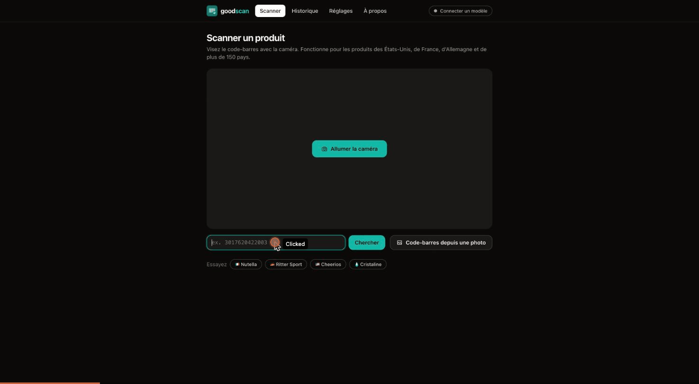

# goodscan

Scan a food barcode and see if it is good for you. goodscan reads the open databases of
[Open Food Facts](https://world.openfoodfacts.org) and gives a 0–100 health score you can check
line by line: the Nutri-Score, how processed it is, which additives carry a risk according to EFSA
or are not allowed in the EU. It works for products from the US, France, Germany and the 150+
countries Open Food Facts covers, in English, French and German. Set your preferences (allergens,
vegan, low salt…) and it tells you whether a product is for you, the way the Open Food Facts apps
do. Connect your own AI model if you like, to have a score explained, ask questions, or read a
label from a photo when a product is missing. An installable PWA: no account, no server.

**→ [maxgfr.github.io/goodscan](https://maxgfr.github.io/goodscan/)**



## How it works

1. **Scan.** The back camera reads EAN-13, EAN-8, UPC-A and UPC-E codes with the browser's own
   `BarcodeDetector` where there is one (Chrome on Android and macOS), and with ZXing in
   WebAssembly everywhere else (iOS, Firefox, Windows), through the
   [`barcode-detector`](https://github.com/Sec-ant/barcode-detector) ponyfill. The `.wasm` is
   served from this site and cached for offline use. You can also type the digits or pick a
   photo.
2. **Look up.** The page asks the Open Food Facts API v3 directly (CORS is open, no key), in your
   language, then Open Beauty, Pet Food and Products Facts. A UPC-A is also tried as its EAN-13.
   It identifies itself with `X-User-Agent` and brakes itself under the API's 15 reads a minute.
   Products are kept a week in IndexedDB, so a second scan is instant and works offline.

   **By name:** the same field takes a product name, through Open Food Facts' search service
   ([search-a-licious](https://github.com/openfoodfacts/search-a-licious)); the legacy full-text
   search answers 503 to anonymous visitors. That service only allows `localhost` in its CORS
   policy for now ([search-a-licious#427](https://github.com/openfoodfacts/search-a-licious/issues/427)),
   so the app asks once per session whether it answers from the page and offers name search only
   then: it turns on by itself the day the policy opens. A deployment can point
   `VITE_SEARCH_ENDPOINT` at its own proxy meanwhile.
3. **Score.** Deterministic and explained, in [`src/score/score.ts`](src/score/score.ts):
   - start from nutrition: the 2023 Nutri-Score mapped onto 0–100 (A ≈ 85–100 … E ≈ 0–23),
     the database's, or one goodscan computes from the nutrition facts when the database could
     not (Nutella in France, label photos); our computation matches Open Food Facts' own on
     every product that has one;
   - processing: −12 for ultra-processed (NOVA 4), −4 for processed (NOVA 3);
   - additives: −15 for a high risk of overexposure in EFSA's re-evaluations (the score then
     cannot pass 49), −6 for a moderate one, −25 for an additive the EU does not authorise, such
     as titanium dioxide or potassium bromate (the score cannot pass 25); −6 when science weighs
     against it (see [Science](#science)), never on top of the two stronger ones; −45 at most in
     all;
   - organic +5, palm oil −3; water is 100, alcohol 20 at most;
   - 75 and up is excellent, 50 good, 25 poor, below that bad.
4. **Your market first.** With a US browser, the FDA-style box comes first: saturated fat, sodium
   and added sugars per serving, Low (≤ 5 % DV) / Med / High (≥ 20 % DV), as in the FDA's
   proposed front-of-package "Nutrition Info" box. Elsewhere the Nutri-Score, NOVA and Green-Score
   come first. You can switch in Settings.
5. **For you.** Open Food Facts computes, for every product, how it does on 28 attributes
   (Nutri-Score, low salt, no gluten, vegan, palm-oil free, organic…), titled in your language.
   goodscan matches them against your preferences the way the Open Food Facts website and apps do:
   important ×1, very important ×2, mandatory ×2 and it rules a product out when it fails.
6. **Ask AI (optional).** Connect a model through
   [llm-connect](https://github.com/maxgfr/llm-models/tree/main/packages/llm-connect) (OpenAI,
   Anthropic, Gemini, Mistral, OpenRouter, any provider in the
   [llm-models](https://github.com/maxgfr/llm-models) catalog, or a local server such as Ollama or
   LM Studio) to explain a score, answer a question about the product, or read the nutrition
   facts and ingredients from a photo. Label values go through the same score, marked "estimated
   by AI": the model never gives the score itself.

## Science

Under each additive, a "What science says" panel lists what is known about it, finding by
finding: an official position (WHO, IARC, JECFA, EFSA, FDA, ANSES) or a study in people (cohort,
trial, meta-analysis), in animals or in the lab, each marked as a concern or reassuring, with its
source, its year and a link to its DOI or PubMed record. Sweeteners (aspartame, acesulfame K,
sucralose, erythritol…), emulsifiers (carrageenan, carboxymethylcellulose, mono- and diglycerides,
polysorbate 80), the Southampton azo colours, titanium dioxide, erythrosine, nitrites and nitrates
and a few more are covered, in [`src/data/evidence.ts`](src/data/evidence.ts).

The findings come from a deep, verified literature research with
[ultrasearch](https://github.com/maxgfr/ultrasearch) in
[docs/research/additives-evidence](docs/research/additives-evidence/README.md): every claim cites a
fetched source, was checked against it by an adversarial pass, and every DOI and PMID was
resolved on Crossref and PubMed. Only claims that passed are in the app.

The score counts a finding only when it is weighty: an official position of concern, or at least
two human studies that agree. Then the additive costs 6 points, in food as in drinks (the
Nutri-Score only counts sweeteners in drinks). A single study, or animal and lab work, is shown
but costs nothing. An additive EFSA already rates at a high risk of overexposure, or that the EU
does not authorise, keeps that stronger penalty alone.

## Sources

The data choices were checked with a cited, verified web research (116 sources) in
[docs/research](docs/research/README.md), and against the live APIs by `bun run e2e-live`.
- Products, additives taxonomy, preference attributes: Open Food Facts and its sister databases,
  [ODbL](https://opendatacommons.org/licenses/odbl/1-0/); images CC BY-SA. Each product page links
  back to its Open Food Facts page. `bun run additives` and `bun run attributes` refresh the
  extracts in `src/data/` from the live taxonomy.
- Additive risks: EFSA re-evaluations, as recorded by Open Food Facts
  (`efsa_evaluation_overexposure_risk`), plus a short hand-kept list of additives the EU does not
  authorise ([`src/data/eu.ts`](src/data/eu.ts)).
- What science says: official positions and human studies, cited with their DOI or PMID
  ([docs/research/additives-evidence](docs/research/additives-evidence/README.md)).
- Nutri-Score 2023 tables: the Nutri-Score Scientific Committee's updated algorithm (in force in
  Germany and France since 2024–2025).
- US box: FDA Daily Values (saturated fat 20 g, sodium 2300 mg, added sugars 50 g).

goodscan is a guide, not medical advice; data can be wrong or out of date.

## Privacy

- History, cached products and preferences stay in your browser (IndexedDB, localStorage). One
  button erases them.
- The page talks to Open Food Facts and, if you connect one, to your AI provider, straight from
  your browser. The API key is encrypted at rest under a non-extractable WebCrypto key.
- A strict Content Security Policy: scripts only from this site, images only from this site and
  the Open *Facts image servers.

## Develop

```bash
bun install
bun run dev        # http://localhost:5173
bun run test       # unit tests (score, Nutri-Score, matching, API client, i18n, AI)
bun run test:e2e   # build + Playwright, incl. a real camera scan from a fake video
bun run e2e-live   # against the real Open Food Facts (by hand)
bun run typecheck && bun run lint
```

A deployment can offer a model without visitors' keys by building with `VITE_LLM_ENDPOINT` (an
OpenAI-compatible proxy holding the key) and `VITE_LLM_MODEL`.

Stack: Bun, Vite, React, Tailwind, vite-plugin-pwa, barcode-detector (ZXing WebAssembly),
llm-connect and llm-models, AI SDK, zod, Playwright. MIT license.
